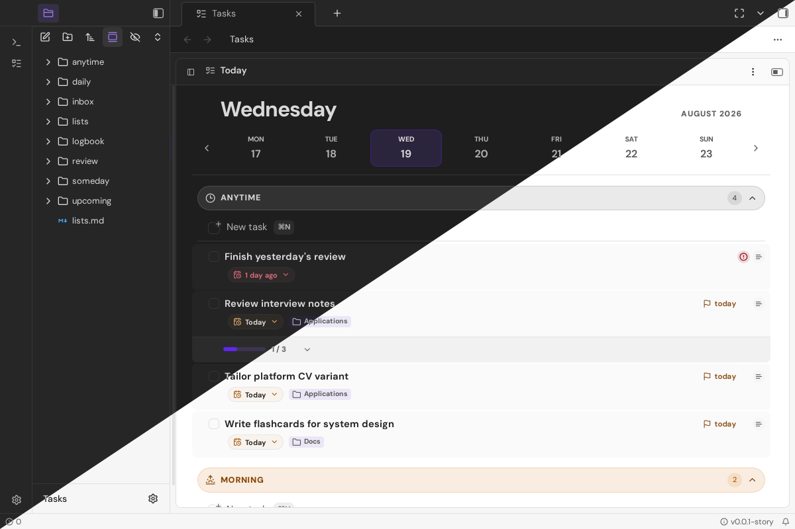
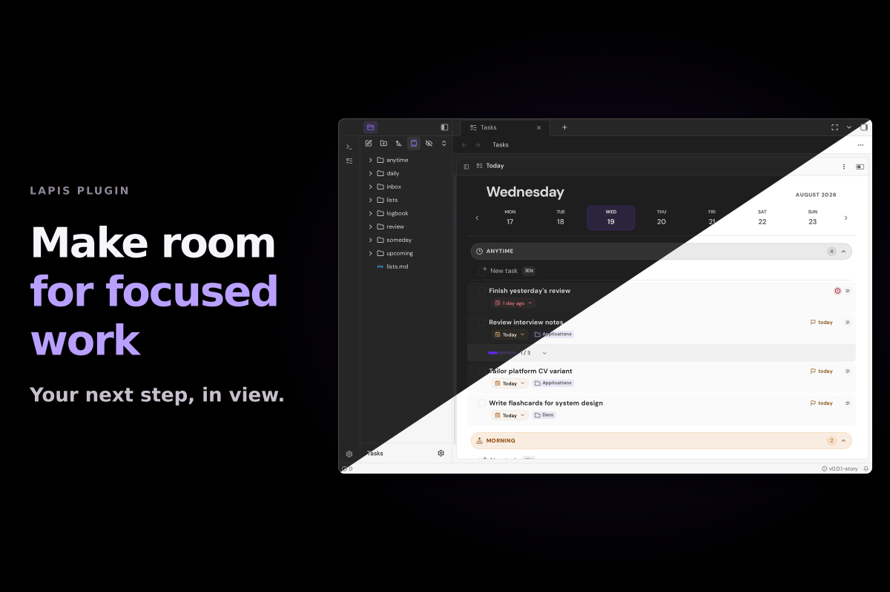
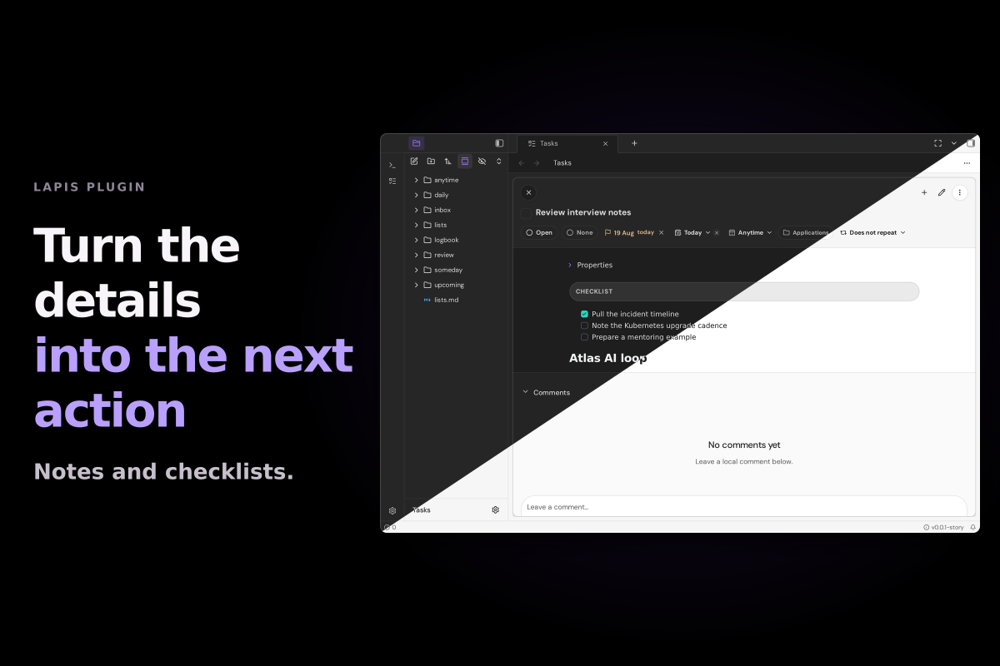

# Tasks for Lapis

[](https://github.com/lapismd/lapis-plugin-tasks/actions/workflows/ci.yml)
[](https://github.com/lapismd/lapis-plugin-tasks/actions/workflows/publish-storybook-pages.yml)
[](https://www.npmjs.com/package/@lapis-notes/lapis-plugin-tasks)
[](https://lapismd.github.io/lapis-plugin-tasks/)

`@lapis-notes/lapis-plugin-tasks` is the first-party external Tasks plugin for
Lapis. It ships a vault-backed planner runtime and a Design Core-backed catalog.
The package Storybook includes a real Lapis workspace that loads the plugin.

The runtime plugin ID is `tasks`.

[](registry-assets/banner.full.webp)

<details>
<summary>Plugin screenshots</summary>

[](registry-assets/gallery/planner.full.webp)

[](registry-assets/gallery/details.full.webp)

</details>

Registry publication and manual verification: [publishing guide](docs/registry-publishing.md).

## Development

Published LapisMD dependencies resolve through npm semver ranges. Package
manifests must stay portable and contain no machine-specific dependency ranges.

```sh
pnpm install
pnpm spec:check
pnpm check
pnpm test
pnpm build
pnpm test:storybook
pnpm build-storybook
```

Package Storybook defaults to port 7030.

### Refreshing local development dependencies

When the sibling repositories are present, `.pnpmfile.cjs` installs local
package snapshots for development acceptance. These snapshots need refreshing
after sibling source or public exports change. If Storybook reports missing
files that exist in the owning repository, stop it and refresh the snapshots:

```sh
pnpm storybook:stop
pnpm install --lockfile=false --force
pnpm test
pnpm test:storybook
pnpm storybook
```

This temporary local validation setup leaves the registry lockfile unchanged.
Validate releases and CI against the published registry dependencies.

### Temporary browser acceptance mitigation

`pnpm test:storybook` intermittently loses the Vitest orchestrator connection
between story files. The reported transport errors are `Browser connection was
closed` and `rpc is closed, cannot call "createTesters"`; the cause remains open.

Run `node scripts/test-storybook-batches.mjs` for complete acceptance in three
sequential Vitest shards, each with a fresh browser process and one worker.
Every discovered story and existing interaction/axe assertion remains included.
The runner stops at the first failed batch. Keep the unbatched command available
for diagnosis; remove this mitigation once the transport is reliably fixed.

The preview inherits DM Sans Variable and Source Code Pro Variable from Design
Core, matching the Lapis hosts. Settings headings use the shared compact heading
tokens (16px, regular weight) rather than a demo-specific override.

The [10 October review record](spec/records/2026-10-10-review.md) lists the
repaired failures, acceptance counts, and deferred runner issue.

## CI and local parity

`pnpm validation:all` runs the complete Docker aggregate in one worker:
governance and source checks, unit and native tests, package build, publint,
static Storybook, the three Storybook interaction shards, specification, and
immutable release preparation. It stops at the first failure.

Local task output can be cached under `.turbo/`. The same tasks use the signed
organization cache in CI and fail open to normal execution when it is
unavailable. To use the remote cache locally, copy `.env.example` to the ignored
root `.env` and provide `TURBO_TOKEN` and
`TURBO_REMOTE_CACHE_SIGNATURE_KEY`. Never commit those credentials.

CI fans the Docker lanes out in parallel: Governance, Quality, Unit tests,
Native, Static Storybook, and Storybook interactions (1/3), (2/3), and (3/3).
Each lane sets up pnpm, Node 24, and the pinned Jujutsu tool, then selects the
exact source revision. Dependency audits run after those lanes. Validate fails
unless every required lane succeeds, then prepares the npm artifact. `main` is
not branch-protected; Validate is the gate. The same `CI and npm release`
workflow then runs `Version packages`, which opens the changeset pull request
and does not publish. `Publish and verify npm release` runs only on `main`
after that pull request merges and no changesets remain. An npm version that
already exists is not uploaded again; the job checks the published tarball's
size, SHA-256, and provenance and succeeds. `Publish Storybook to GitHub Pages`
builds with `pnpm build-storybook` and deploys
`https://lapismd.github.io/lapis-plugin-tasks/`.

## npm releases

The [canonical release operations](spec/src/spec-governance.md#npm-release-operations)
define the Changesets PR, qualification, publication and registry verification
sequence. The specification remains authoritative for release status and gates.

### Temporary Bits UI patch for consumers

Until the upstream fixes are released, this checkout applies the approved
`bits-ui@2.20.2` patch through its pnpm root configuration and frozen lockfile.
It retains the approved LinkPreview cleanup and Slider lifetime guards, and
adds the FocusScope same-container cleanup repair from
[upstream PR #2264](https://github.com/huntabyte/bits-ui/pull/2264).

Published dependency packages do not propagate pnpm patches to applications.
Install the qualified Design Core release as a direct host dependency. Its
`patches/manifest.json`, `patches/bits-ui@2.20.2.patch` and `patches/README.md`
provide the authoritative registry-delivered patch assets. Copy the patch into
the consumer root, verify its SHA256 against that manifest, configure the
root's own `patchedDependencies` and exact Bits override, and regenerate its
lock. Verify the three installed postimage hashes and run affected functional,
interaction and accessibility acceptance.
A successful package installation alone does not qualify an unpatched host.
The [canonical patch requirements](https://github.com/lapismd/lapis-plugin-tasks/blob/main/spec/src/spec-governance.md#temporary-bits-ui-patch)
record provenance and removal conditions. Remove the patch after the repaired
upstream release passes the original regressions and all affected acceptance.
