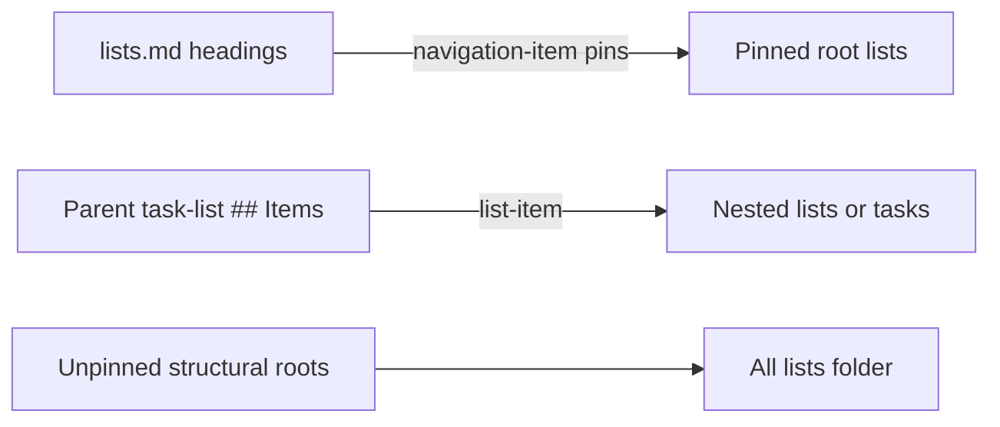

# Lists

Lists are Markdown notes. The sidebar tree is a projection of two graphs:
presentation pins in the navigation file, and structural `list-item` links
under each list’s `## Items`. Owning code is
`src/lib/model/list-navigation.ts`, the snapshot builders in
`src/lib/model/planner.ts`, and
`src/lib/tasks/application-task-planner-mode/TaskListNavTree.svelte`.
See LN-TASK-023 through LN-TASK-027.

## Navigation pins versus structural parents

A vault may include at most one authoritative `task-list-navigation` file,
usually `lists.md`. Extra navigation documents are ignored after a
diagnostic. Headings in that file are sidebar sections, not resources. Links
under those headings pin root lists. The file stays ordinary vault Markdown
and must not live in plugin data.

A `list-item` under a task-list `## Items` is the only structural parent.
`navigation-item` pins are presentation only. A task-list may have at most
one incoming `list-item`. Ordinary `reference` links may point at the same
list from many places. Cycles in the list-item graph are rejected.
`parent()` ignores navigation edges.

Area membership means that same `## Items` parent. See LN-TASK-021.

## Sidebar tree

`buildListNavigationSnapshot` walks pins, then unpinned structural roots.
`TaskListNavTree` renders:

1. A Lists label
2. Default-expanded navigation-section folders
3. Pinned root lists under those folders
4. Nested task-lists from outgoing `list-item` edges whose target `kind` is
   `task-list`
5. All lists, an expandable folder of unpinned structural roots

Tasks do not appear in that tree. Selecting a section does not filter the
planner. Opening a list still shows every `list-item` child, including tasks.
Archived lists (`list.status: archived`) are omitted.

The tree reuses Design Core Explorer indent-guide tokens and nested-sublist
chrome. It supports inline rename and HTML5 list-tree drag with auto-expand.
It must not mount `WorkspaceExplorer`.

## Tree actions

`TaskRepository` rewrites one navigation or list Markdown file, or one
reserved-section rewrite, then reprojects.

| Action | Effect |
| --- | --- |
| Pin / move between sections | Rewrite navigation pins |
| Nest / unnest | Rewrite parent `## Items` and usually unpin |
| Rename list | Rewrite the list title and incoming link titles |
| Rename section | Rewrite the navigation heading, except All lists |
| Create list | Write a new `task-list` file; pin or nest as requested |
| Archive | Set `list.status` to `archived` and drop the pin |
| Delete | Unlink parent or pins, then remove the list file |

Child task files remain after delete. Creating a nested list adds a
`list-item` under the parent.

The list-row context menu offers Open note, Rename, New nested list, Unpin
when the list is a pinned root, Archive, and Delete. Section folders offer
Rename except All lists, and New list.

`ApplicationTaskAreaPicker` is the catalog list picker and composes Design
Core Command View. Creating a task while an existing list is selected
attaches that task to the existing list and must not mint a new id such as
`list-list-applications`. `listsMatch` and `uniqueListPath` in
`src/lib/model/list-navigation.ts` and `apply-catalog-task.ts` own that
identity rule. Catalog writes through `apply-catalog-task.ts` map `planAt`
`morning`, `afternoon`, `evening`, or `HH:mm` onto the task file; `all-day`
is not a stored task token. Catalog `status` `canceled` persists through
`TaskRepository.cancel` as YAML `task.status: canceled`.
Daily-agenda quick-create gives an existing selected list the same structural
membership treatment while taking its plan date and day part from the agenda
section. Scheduling never changes the task's list parent.
