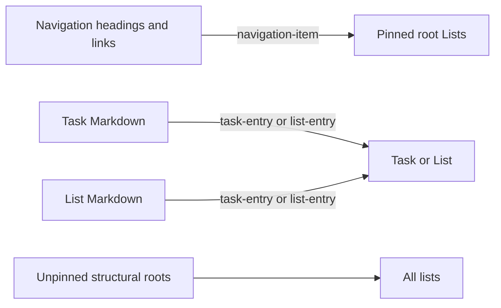

# Lists and hierarchy

Lists are rich Markdown documents, not containers with a generated task body.
The sidebar combines a presentation graph from `task-list-navigation` with the
validated structural graph derived from Task and List documents. See
LN-TASK-021 and LN-TASK-023–027.



## Presentation pins

A vault may include one authoritative `type: task-list-navigation` document,
usually `lists.md`. Its headings are sidebar section labels and its links pin
root Lists. Extra navigation documents are diagnosed and ignored.

Navigation links derive `navigation-item`. They never establish ownership,
never satisfy a parent query, and may point at a List that is also referenced
elsewhere. A nested List pin is ignored in favor of its structural parent.

## Structural parents

Any Task or List can contain a structural Task or List link. Target type
determines `task-entry` or `list-entry`; heading text does not participate.
Structural ownership is singular across both kinds:

```text
Task or List source
  └─ one authored structural link
       └─ Task or List target with at most one distinct parent
```

Whole-vault validation removes conflicting and cyclic edges from the active
graph while keeping the authored Markdown and diagnostics. Repeated occurrences
from the same source are not a second parent. `reference` and
`navigation-item` never count.

Area membership is the incoming Task List → Task `task-entry`. A nested List in
the sidebar is the incoming `list-entry`. A Task → Task/List relationship can
render in the Task detail document but does not turn the Task into a sidebar
folder.

## Sidebar tree

`buildListNavigationSnapshot` renders:

1. Lists;
2. default-expanded navigation-section folders;
3. pinned root Lists;
4. nested Lists reached through validated outgoing `list-entry` edges;
5. All lists, containing unpinned structural roots.

Tasks do not appear in this navigation tree. Opening a List renders mixed Task
and nested-List entries in the Markdown document itself. Archived Lists are
omitted. The tree uses Design Core Explorer guide tokens, supports inline
rename and HTML5 drag with auto-expand, and does not mount
`WorkspaceExplorer`.

## Markdown-native List page

Selecting a List mounts its real `TFile`. All authored headings and rich
content retain their source order. Every resolved contiguous TaskRun is replaced
in place with the shared rich block; unsupported or unresolved candidates stay
ordinary Markdown.

A nested-List entry uses a list icon instead of a task checkbox. It supports:

- row selection;
- recursive in-place disclosure of the child List's own heading-aware runs;
- drag ordering within its current TaskRun;
- explicit drag to a different run or heading;
- deletion through the repository;
- a trailing action that opens the complete child List surface in the adjacent
  column.

Opening or expanding a child does not create ownership. The authored link
already owns the relationship.

## Tree and structural actions

| Action | Source effect |
| --- | --- |
| Pin or move between sidebar sections | Rewrite navigation Markdown only |
| Nest or unnest | Remove/insert the exact structural list item and usually update its pin |
| Sort siblings | Reorder only one contiguous TaskRun |
| Move between headings/runs | Explicitly remove and insert exact item ranges; recompute relative href across documents |
| Rename List | Update its front matter title when present, its H1, and exact incoming structural labels |
| Rename/create grouping heading | Rewrite or append an ordinary H2–H6 Markdown heading |
| Create List | Write a new `task-list` document without inventing a reserved section |
| Archive | Set `list.status: archived` and remove its pin |
| Delete | Unlink structural/navigation parents, remove only the List file, retain children |

The list-row context menu offers Open note, Rename, New nested list, Unpin for a
pinned root, Archive, and Delete. Navigation folders offer Rename except All
lists, and New list.

`ApplicationTaskAreaPicker` remains the catalog List picker. Choosing an
existing List attaches the Task through a structural entry and never mints a
duplicate identifier such as `list-list-applications`. Planning and day-part
changes do not alter structural parenthood.
