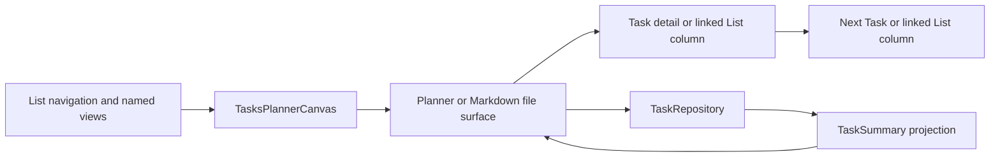

# Planner

The planner is a main-area Tasks view over the Markdown document model. It
derives navigation, date buckets, daily sections, and summary rows without
turning those views into stored task state. The selected Task or List remains a
normal Markdown file and is edited through the repository or Markdown surface
that owns it.

See LN-TASK-010, LN-TASK-012, and LN-TASK-018.

## Responsibilities

The planner has four responsibilities:

1. Compose List navigation, the active planning surface, and a branch-aware
   stack of Task/List detail columns with Design Core Column Canvas.
2. Derive named views and selected-day sections from projected task summaries.
3. Route user actions back to the authoritative Markdown files.
4. Preserve the richer Markdown presentation when a Task or List document is
   opened inside the workspace.

Host movable panels remain unspecified. The package registers one `tasks`
main-area view; Storybook catalog compositions exercise the same public
controllers and components without defining another runtime.

On a wide adaptive canvas, the active adjacent columns share the visible stage
through Design Core's public pair-sizing contract. Tasks keeps its navigation
column narrow and finite while Planner, Detail, and Related are unbounded
content columns. Design Core owns inverse divider movement, collapse-time
stretching, collapsed-rail exclusion and width deduction, per-pair split
restoration, sticky-context reservation, continuous manual scrolling, and the
unchanged compact behavior.

Each Task or nested List opened from the planner or an existing detail appends
one distinct runtime column beside its owning surface. The in-memory detail
stack retains every ancestor and scopes selection plus editor state to the
column that owns it. Selecting a different child from an ancestor replaces
only that ancestor's descendant branch; closing a column removes it and every
descendant while leaving earlier context mounted.

A directly mounted Task detail owns the single visible border, radius, and
surface around its column. Its containing Column Canvas lane remains
transparent and borderless for every runtime detail ID. Linked-List documents
instead retain the standard bordered and rounded Column Canvas treatment. The
title of the selected List column and every linked-List detail column begins
with the same List glyph used by structural nested-List rows, while Task detail
chrome remains task-specific.

## Planner state model

The planner combines disposable query state with short-lived presentation
state:

| State | Owner | Persistence |
| --- | --- | --- |
| Task status, plan, deadline, recurrence, tracking, and comments | Task Markdown | Persisted in the Task file |
| Effective occurrence and historical statistics | Resolver plus projections | Disposable and date-sensitive |
| Task/List membership and order | Structural Markdown links | Persisted at exact list-item ranges |
| Task summaries and relationships | AppDatabase projection | Disposable and rebuildable |
| Selected bucket, List, Task, or date | Planner controller | In memory |
| Section disclosure and ordered detail-column branch | Planner presentation | In memory |
| Day-part boundaries | Versioned Tasks plugin settings | Persisted as plugin-owned settings |
| Hide completed tasks | Today presentation | In memory |
| Hide overdue tasks | Versioned Tasks plugin settings | Persisted as plugin-owned settings |

Today, Review, Upcoming, Anytime, and Logbook are query results, not document
fields. Recurring placement uses one effective occurrence: Review contains
only carried overdue occurrences and Upcoming contains only the next effective
date. Daily section placement is derived from the effective date, `plan.at`,
status, completion time, and the configured clock boundaries. See [Daily
agenda](./planner/daily-agenda.md).

Catalog adapters retain recurrence, tracking, effective state, effective date,
and the resolver date. Classification, upcoming grouping, selected-day
inclusion, and overdue decoration consume those effective fields. Paused and
exhausted recurrence remains open in Anytime rather than surfacing a stale plan.

When Today selects a date before local today, the planner swaps its actionable
day sections for occurrence history. The workspace queries disposable
`tasks/occurrence` rows for that date and merges them with RRULE expectations;
the presentation labels completed, missed, and unrecorded outcomes and offers
all/completed/missed filters. It does not reopen daily Markdown files. Returning
to today restores the current actionable sections and their ordinary planner
controls.

Every named planner destination repeats its navigation icon before the title in
the planner-column header. The label, icon, navigation count, rendered rows,
and empty state all come from the same selected bucket rather than separate
view-specific headers.

Today presents its selected weekday and week strip in one sticky calendar
surface. That surface paints through the same inline overflow as the task rows
beneath it, while retaining the surrounding planner padding and scrollbar
gutter. Carried-over rows expose an overdue marker beside their detail control,
and the Today actions menu names its persisted overdue toggle for the action it
will perform: **Hide overdue tasks** or **Show overdue tasks**. Day-part
boundaries and the overdue default are available through both the host's public
Tasks settings section and the legacy plugin settings tab.

The planner passes its injected local clock through every rendered Task row.
Date-sensitive row controls therefore use the same `today` as the agenda:
opening recurrence derives its shortcut labels from the effective plan date,
and choosing schedule recurrence for an unplanned Task atomically creates an
Anytime plan and RRULE start for that injected date. Standalone Task surfaces use their own injected clock or the
local system clock when the host does not supply one. See LN-TASK-048.

The shared quick-create row supplies the same compact input, focused actions,
normal-weight label, and block-end separation in daily sections, named views,
and Markdown TaskRuns. Individual pages do not add their own spacing fixes.
Expanded row metadata composes the shared Design Core controls throughout,
including structured recurrence controls and raw RRULE editing; planner pages
do not substitute native form dropdowns. The compact recurrence popover starts
directly with its presets, keeps a no-apply `Repeat every…` number/frequency
row behind one disclosure, and hands `Custom recurrence…` to a separately
scrollable, flat, full-height Design Core Form Sheet while closing the popover.
Its compact header uses the stronger Task-detail title weight and reuses the
Task-detail close control's bordered circular geometry, centered icon scale,
and shadow, with a grey resting surface and stronger hover contrast against the
white or themed sheet surface.
The sheet follows the Tasks settings composition: calendar-like weekday toggles,
Inline Option Picker pop-out controls for three-or-more option choices,
Segmented Control for two-option choices, Switch controls for boolean policy,
Cycle Picker for tracking type, and Chip Autocomplete for RDATE/EXDATE. The
inline-option and segmented rows keep their labels and values on one row at
desktop widths so the sheet stays compact. Behavior segmented controls keep
their option labels unwrapped and use the normal form surface for unselected
segments over the grey settings-card panel. Repeat-interval inputs and weekday
cells also use that form surface over grey panels. Date chips share the plan-date selector's
natural-language parser and normalize against the injected clock before the
canonical local dates are persisted. Their suggestion popovers remain inside
the sheet so accepting a suggestion is not treated as an outside interaction.
The custom sheet also accepts
natural-language recurrence descriptions through rrule.js and presents a
friendly `toText()` summary instead of exposing the stored property value as
the primary label. Nested controls edit a draft: tag suggestions, date values,
Select choices, and recurrence matches remain in the sheet until the explicit
Apply action. See LN-TASK-046.
The editor also owns weekday sets, monthly positional and calendar-day rules,
yearly month/day, COUNT or date-only UNTIL, RDATE/EXDATE, missed policy,
checklist reset, pause state, and habit tracking. Unsupported raw rules and
opaque legacy blocks render actionable warnings and remain `visual-pending`.
The shared plan-time popover presents day parts and clock shortcuts in compact
two-column groups, keeping their smaller section titles subordinate to the
options themselves.

## Component map

The implementation is described in three focused chapters:

- [Workspace surfaces](./planner/workspace-surfaces.md) describes Column Canvas,
  full-file Markdown surfaces, editor ownership, and shell acceptance.
- [Daily agenda](./planner/daily-agenda.md) describes named buckets, selected
  dates, day-part routing, quick-create, and drag behavior.
- [Task rows and checklists](./planner/task-rows.md) describes shared Task and
  nested-List rows, selection, detail opening, headings, and lazy checklist
  interaction.

The task and recurrence schemas are defined separately in [Task documents and
structural runs](./documents.md) and [RRULE
recurrence](./documents/recurrence.md).

## Catalog boundary

Canonical planner types use the Markdown-first schema. CV-only
`applicationId`, `linkedTo`, and `JobApplication` shapes stay in catalog
fixtures and must not become document types. See LN-TASK-011.
