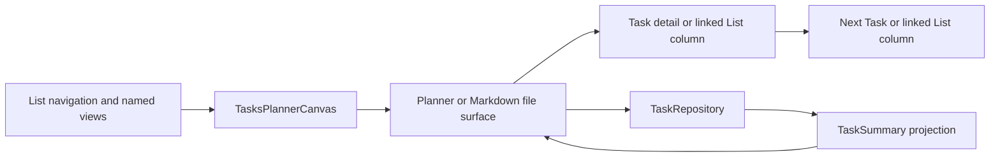

# Planner

The planner is a main-area Tasks view over the Markdown document model. It
derives navigation, date buckets, daily sections, and summary rows without
turning those views into stored task state. The selected Task or List remains a
normal Markdown file and is edited through the repository or Markdown surface
that owns it.

See LN-TASK-010, LN-TASK-012, and LN-TASK-018.

## Responsibilities

The planner has four responsibilities:

1. Compose List navigation, the active planning surface, and a branch-aware
   stack of Task/List detail columns with Design Core Column Canvas.
2. Derive named views and selected-day sections from projected task summaries.
3. Route user actions back to the authoritative Markdown files.
4. Preserve the richer Markdown presentation when a Task or List document is
   opened inside the workspace.

Host movable panels remain unspecified. The package registers one `tasks`
main-area view; Storybook catalog compositions exercise the same public
controllers and components without defining another runtime.

On a wide adaptive canvas, the active adjacent columns share the visible stage
through Design Core's public pair-sizing contract. Tasks keeps its navigation
column narrow and finite while Planner, Detail, and Related are unbounded
content columns. Design Core owns inverse divider movement, collapse-time
stretching, collapsed-rail exclusion and width deduction, per-pair split
restoration, sticky-context reservation, continuous manual scrolling, and the
unchanged compact behavior.

Each Task or nested List opened from the planner or an existing detail appends
one distinct runtime column beside its owning surface. The in-memory detail
stack retains every ancestor and scopes selection plus editor state to the
column that owns it. Selecting a different child from an ancestor replaces
only that ancestor's descendant branch; closing a column removes it and every
descendant while leaving earlier context mounted.

A directly mounted Task detail owns the single visible border, radius, and
surface around its column. Its containing Column Canvas lane remains
transparent and borderless for every runtime detail ID. Linked-List documents
instead retain the standard bordered and rounded Column Canvas treatment. The
title of the selected List column and every linked-List detail column begins
with the same List glyph used by structural nested-List rows, while Task detail
chrome remains task-specific.

## Planner state model

The planner combines disposable query state with short-lived presentation
state:

| State                                                           | Owner                           | Persistence                                              |
| --------------------------------------------------------------- | ------------------------------- | -------------------------------------------------------- |
| Task status, plan, deadline, recurrence, tracking, and comments | Task Markdown                   | Persisted in the Task file                               |
| Effective occurrence and historical statistics                  | Resolver plus projections       | Disposable and date-sensitive                            |
| Task/List membership and order                                  | Structural Markdown links       | Persisted at exact list-item ranges                      |
| Task summaries and relationships                                | AppDatabase projection          | Disposable and rebuildable                               |
| Selected bucket, List, Task, or date                            | Planner controller              | In memory                                                |
| Section disclosure and ordered detail-column branch             | Planner presentation            | In memory                                                |
| Day-part boundaries                                             | Versioned Tasks plugin settings | Persisted as plugin-owned settings                       |
| Hide completed tasks                                            | Today presentation              | In memory                                                |
| Hide overdue tasks                                              | Versioned Tasks plugin settings | Persisted as plugin-owned settings                       |
| Navigation column state (`expanded`, `collapsed`, or `hidden`)  | Versioned Tasks plugin settings | Persisted as plugin-owned settings                       |
| Navigation preview                                              | Column Canvas controller        | Transient; never persisted or emitted as a layout change |

Today, Review, Upcoming, Anytime, and Logbook are query results, not document
fields. Recurring placement uses one effective occurrence: Review contains
only carried overdue occurrences and Upcoming contains only the next effective
date. Daily section placement is derived from the effective date, `plan.at`,
status, completion time, and the configured clock boundaries. See [Daily
agenda](./planner/daily-agenda.md).

Catalog adapters retain recurrence, tracking, effective state, effective date,
and the resolver date. Classification, upcoming grouping, selected-day
inclusion, and overdue decoration consume those effective fields. Paused and
exhausted recurrence remains open in Anytime rather than surfacing a stale plan.

Catalog Markdown fixtures resolve effective occurrences at their injected
fixture date, including all three recurring morning/midday Tasks. The fixed
Today agenda contains eight open rows, and expanded navigation, collapsed
navigation, and tooltips all report that same total. Task detail accepts an
optional host-owned related-actions snippet in its header chrome, separate from
the under-title metadata controls; the catalog uses it to open the related
application column without adding CV policy to canonical Tasks.

Warning text and icons in deadline, waiting-status, and schedule controls use a
foreground-mixed `--ui-tasks-warning-text` token so small text and non-text
indicators meet WCAG AA in light and dark Default and Obsidian themes. Shell contrast acceptance covers all four theme
and color-mode combinations.

When Today selects a date before local today, the planner swaps its actionable
day sections for occurrence history. The workspace queries disposable
`tasks/occurrence` rows for that date and merges them with RRULE expectations;
the presentation labels completed, missed, and unrecorded outcomes and offers
all/completed/missed filters. It does not reopen daily Markdown files. Returning
to today restores the current actionable sections and their ordinary planner
controls.

Every named planner destination repeats its navigation icon before the title in
the planner-column header. The label, icon, navigation count, rendered rows,
and empty state all come from the same selected bucket rather than separate
view-specific headers.

The leading navigation column has three durable presentation states. Expanded
shows the complete named-view and List tree. Collapsed retains a narrow rail
with an explicit expand action, the seven named-view icons, and a Lists action;
each action exposes the same derived count in a Tooltip, and Lists opens the
complete editable tree in a collision-aware, internally scrollable Popover.
Hidden removes the navigation column from inline layout. The first action in
the Planner header targets this navigation column, so it can restore either a
collapsed or hidden column while the Planner column's own collapse action stays
at the far end of the header.

On wide and fixed canvases, a collapsed or hidden navigation column can preview
its complete expanded content as a full-height overlay. The edge trigger opens
that preview immediately; the adjacent Planner-header toggle uses the shared
600ms open and 120ms dismissal delays. Preview is transient and does not change
the saved state. Selecting a destination dismisses the overlay while retaining
the underlying collapsed or hidden value. Focus and owned portalled menus,
selects, and popovers keep the preview active. Compact presentation retains
ordinary Column Canvas lanes and the adjacent click recovery action, but does
not expose hover previews.

The collapsed Lists Popover stays open for tree disclosure, rename, context
actions, and rearrangement. Selecting a List closes the Popover, opens the List
in Planner, and leaves navigation collapsed. Neither collapsed nor hidden
navigation exposes task-drop hosts or expands during a task drag; dropping a
task onto a List remains an expanded-navigation workflow. See LN-TASK-056.

Today presents its selected weekday and week strip in one sticky calendar
surface. That surface paints through the same inline overflow as the task rows
beneath it, while retaining the surrounding planner padding and scrollbar
gutter. At constrained sidebar widths, the sticky calendar starts at the top of
the scroll viewport and spans the full planner width, while the task rows retain
reduced inline padding, leave a scrollbar-side gutter, and the week strip
switches to single-letter visible weekday labels. Carried-over rows expose an
overdue marker beside their detail control,
and the Today actions menu names its persisted overdue toggle for the action it
will perform: **Hide overdue tasks** or **Show overdue tasks**. Day-part
boundaries and the overdue default are available through both the host's public
Tasks settings section and the legacy plugin settings tab.

The planner passes its injected local clock through every rendered Task row.
Date-sensitive row controls therefore use the same `today` as the agenda:
opening recurrence derives its shortcut labels from the effective plan date,
and choosing schedule recurrence for an unplanned Task atomically creates an
Anytime plan and RRULE start for that injected date. Standalone Task surfaces use their own injected clock or the
local system clock when the host does not supply one. See LN-TASK-048.

The shared quick-create row supplies the same compact input, focused actions,
normal-weight label, and block-end separation in daily sections, named views,
and Markdown TaskRuns. Individual pages do not add their own spacing fixes.
Collapsed planner rows show planned schedule and recurrence at the start of the
lower metadata row, before application and List chips. Those controls reuse the
same picker components as the expanded inline editor but use compact oval chip
surfaces. Planned schedule chips derive their tone from the row's injected
local clock: destructive red treatment is reserved for overdue planned dates,
which render as `N days ago` and expose the full planned date in a tooltip.
Morning, Afternoon, and Evening schedule chips show the matching day-part icon
immediately before the day-part text. Deadline remains the existing title-row
due indicator and is not moved into the lower metadata row.
Canceled task rows retain checked terminal semantics but replace the completed
checkbox tick with the canceled `CircleX` glyph in destructive red. Read-only
row icons and legacy planner fallback rows use that same canceled treatment,
while nested checklist items retain the normal completed tick. See LN-TASK-057.
Expanded row metadata and the Task detail under-title action row compose the
same layout-transparent metadata action component throughout, including
status, priority, deadline, structured List, recurrence, and raw RRULE editing;
their host rows own the wrapping flex layout and planner pages do not
substitute native form dropdowns. The List picker keeps the Command View
surface, showing display titles with wrapped Markdown file paths and optional
navigation breadcrumbs from the List tree. Tasks-owned Command View popovers
that replace Popover padding with internal list spacing also clear the inherited
Popover content gap, so direct children do not add another layout gap around
menu content. The compact recurrence popover header starts with the current
RRULE's friendly text, not the selected-date label. When a planned or
repeat-start date exists and the rule does not already carry a day/date
selector, the date is appended as muted anchor context such as `on the 18th`;
undated tasks omit that context. The header then provides the same
natural-language recurrence Command used by the custom sheet. Natural-language
recurrence accepts omitted leading `every` by retrying with that prefix before
reporting no match, and weekend phrases persist the canonical Saturday/Sunday
RRULE. The compact recurrence preset list includes weekday and weekend
shortcuts. Its natural-language command remains bounded to the fixed-width
popover, wraps long suggestion text, gives the input only a neutral grey
search-style focus ring without changing the border, and uses the same neutral
grey suggestion hover and selected states as the preset menu items rather than
the recurrence accent. Suggestions use a two-row label/shortcut layout with an
explicit label element and an independent shortcut row so inherited Command
shortcut or check-icon styles cannot place RRULE values over the label. The
natural-language command clips its children to the outer input radius and keeps
the inner input group square so inherited input backgrounds cannot leak through
the rounded corners. Only the preset list scrolls;
`Repeat every…` and `Custom recurrence…` stay pinned in the popover footer. Its
no-apply `Repeat every…` disclosure uses an unlabeled transparent control row:
a number input and Forms Inline Option Picker frequency control share one row.
`Custom recurrence…` opens a separately
scrollable, flat, full-height Design Core Form Sheet while closing the popover.
Its compact header uses the stronger Task-detail title weight and reuses the
Task-detail close control's bordered circular geometry, centered icon scale,
and shadow, with a grey resting surface and stronger hover contrast against the
white or themed sheet surface.
The sheet follows the Tasks settings composition: calendar-like weekday toggles,
Inline Option Picker pop-out controls for three-or-more option choices,
Segmented Control for two-option choices, Switch controls for boolean policy,
Cycle Picker for tracking type, and Chip Autocomplete for RDATE/EXDATE. The
inline-option and segmented rows keep their labels and values on one row at
desktop widths so the sheet stays compact. Behavior segmented controls keep
their option labels unwrapped and use the normal form surface for unselected
segments over the grey settings-card panel. Repeat-interval inputs and weekday
cells also use that form surface over grey panels. Date chips share the plan-date selector's
natural-language parser and normalize against the injected clock before the
canonical local dates are persisted. Their suggestion popovers remain inside
the sheet so accepting a suggestion is not treated as an outside interaction.
The custom sheet also accepts
natural-language recurrence descriptions through rrule.js and presents a
friendly `toText()` summary instead of exposing the stored property value as
the primary label. Nested controls edit a draft: tag suggestions, date values,
Select choices, and recurrence matches remain in the sheet until the explicit
Apply action. See LN-TASK-046.
The editor also owns weekday sets, monthly positional and calendar-day rules,
yearly month/day, COUNT or date-only UNTIL, RDATE/EXDATE, missed policy,
checklist reset, pause state, and habit tracking. Unsupported raw rules and
opaque legacy blocks render actionable warnings and remain `visual-pending`.
The shared plan-time popover presents day parts and clock shortcuts in compact
two-column groups, keeping their smaller section titles subordinate to the
options themselves.

## Component map

The implementation is described in three focused chapters:

- [Workspace surfaces](./planner/workspace-surfaces.md) describes Column Canvas,
  full-file Markdown surfaces, editor ownership, and shell acceptance.
- [Daily agenda](./planner/daily-agenda.md) describes named buckets, selected
  dates, day-part routing, quick-create, and drag behavior.
- [Task rows and checklists](./planner/task-rows.md) describes shared Task and
  nested-List rows, selection, detail opening, headings, and lazy checklist
  interaction.

The task and recurrence schemas are defined separately in [Task documents and
structural runs](./documents.md) and [RRULE
recurrence](./documents/recurrence.md).

## Catalog boundary

Canonical planner types use the Markdown-first schema. CV-only
`applicationId`, `linkedTo`, and `JobApplication` shapes stay in catalog
fixtures and must not become document types. See LN-TASK-011.

Real workspace acceptance MUST materialize each virtualized editor target through
native document navigation before querying or activating it. After verifying the
Notes heading at the document end, the story MUST return to the document start
before activating the task run's source control, including in short canvases.

Double-click opens the compact inline editor immediately in both agenda and
List task rows. Notes mount the public API `Editor` with the App's complete
registered Markdown live-preview extensions, loading only the authored Task
body below the separately editable title. The editor grows with its content
and uses the compact row's typography through public Mira tokens. It has no
Edit/Read toggle, front matter, properties panel, or duplicate
document title. The existing title and compact footer controls retain their
styling. Notes save on blur and flush before collapse or navigation. Guarded
source mutations preserve concurrent title/metadata changes, reject concurrent
body changes, and keep failed drafts visible for retry. Full-document Markdown
editing remains available from the column header. See LN-TASK-068.

The body fragment uses external persistence and has no whole-file attachment.
Tasks retains guarded repository saves rather than letting the editor write
the fragment as a complete file. Blur reads the live buffer immediately;
collapse and navigation await its flush. Source-path context resolves relative
Markdown links. Configuration and plugin changes refresh the registered
extension stack, and teardown destroys the editor and its listeners. If no
Markdown editor provider is registered, the surface reports its unavailability.

Runtime action capabilities govern all row controls. Local comments,
duplication, supported browser printing, copyable Lapis URLs, direct-child bulk
actions, recurrence skip, and bounded tracked history are owned by Tasks.
Logbook retains seven navigation destinations and adds All, Completed, and
Canceled filters.

The standalone Column Canvas catalog fixture has no vault-backed List mutation
callbacks. It omits those actions and verifies selection, popover navigation,
and task editing. Vault-backed List actions are exercised in the real App shell.

Task comments use Design Core `MessageList`, `Message`, `MessageBubble`,
`MessageMetadata`, `TokenizedText`, and `Composer` from the public
`@lapismd/design-core/ai/chat` entry point, matching Lapis AI's transcript
composition. Local comments use user-message alignment and shared bubble and
composer tokens. Timestamps retain their authored `datetime`; edited/resolved
state and compact accessible action controls appear in the message metadata.
Posting by the Send control or Enter persists through the existing guarded
repository lifecycle. A failed post restores the draft for retry; editing,
resolution, reopening, and deletion keep their existing semantics. See
LN-TASK-061.

Comments and History use the public Design Core shadcn Accordion family with
its leading right/down disclosure chevrons. Comments start open and History
starts closed; both sections can be open independently. The shared trigger owns
keyboard handling, `aria-expanded`, focus treatment, and icon state. Collapsing
and reopening Comments retains an unsent draft. These section headings use
level two beneath the Task title.
