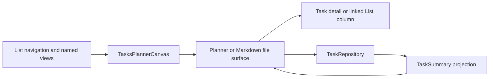

# Planner

The planner is a main-area Tasks view over the Markdown document model. It
derives navigation, date buckets, daily sections, and summary rows without
turning those views into stored task state. The selected Task or List remains a
normal Markdown file and is edited through the repository or Markdown surface
that owns it.

See LN-TASK-010, LN-TASK-012, and LN-TASK-018.

## Responsibilities

The planner has four responsibilities:

1. Compose List navigation, the active planning surface, and optional detail
   columns with Design Core Column Canvas.
2. Derive named views and selected-day sections from projected task summaries.
3. Route user actions back to the authoritative Markdown files.
4. Preserve the richer Markdown presentation when a Task or List document is
   opened inside the workspace.

Host movable panels remain unspecified. The package registers one `tasks`
main-area view; Storybook catalog compositions exercise the same public
controllers and components without defining another runtime.

## Planner state model

The planner combines disposable query state with short-lived presentation
state:

| State | Owner | Persistence |
| --- | --- | --- |
| Task status, plan, deadline, recurrence, and comments | Task Markdown | Persisted in the Task file |
| Task/List membership and order | Structural Markdown links | Persisted at exact list-item ranges |
| Task summaries and relationships | AppDatabase projection | Disposable and rebuildable |
| Selected bucket, List, Task, or date | Planner controller | In memory |
| Section disclosure and open detail columns | Planner presentation | In memory |
| Day-part boundaries | Versioned Tasks plugin settings | Persisted as plugin-owned settings |
| Hide completed tasks | Today presentation | In memory |
| Hide overdue tasks | Versioned Tasks plugin settings | Persisted as plugin-owned settings |

Today, Review, Upcoming, Anytime, and Logbook are query results, not document
fields. Daily section placement is derived from `plan.date`, `plan.at`, status,
completion time, and the configured clock boundaries. See [Daily
agenda](./planner/daily-agenda.md).

Every named planner destination repeats its navigation icon before the title in
the planner-column header. The label, icon, navigation count, rendered rows,
and empty state all come from the same selected bucket rather than separate
view-specific headers.

Today presents its selected weekday and week strip in one sticky calendar
surface. That surface paints through the same inline overflow as the task rows
beneath it, while retaining the surrounding planner padding and scrollbar
gutter. Carried-over rows expose an overdue marker beside their detail control,
and the Today actions menu names its persisted overdue toggle for the action it
will perform: **Hide overdue tasks** or **Show overdue tasks**. Day-part
boundaries and the overdue default are available through both the host's public
Tasks settings section and the legacy plugin settings tab.

The shared quick-create row supplies the same compact input, focused actions,
normal-weight label, and block-end separation in daily sections, named views,
and Markdown TaskRuns. Individual pages do not add their own spacing fixes.

## Component map

The implementation is described in three focused chapters:

- [Workspace surfaces](./planner/workspace-surfaces.md) describes Column Canvas,
  full-file Markdown surfaces, editor ownership, and shell acceptance.
- [Daily agenda](./planner/daily-agenda.md) describes named buckets, selected
  dates, day-part routing, quick-create, and drag behavior.
- [Task rows and checklists](./planner/task-rows.md) describes shared Task and
  nested-List rows, selection, detail opening, headings, and lazy checklist
  interaction.

The task and recurrence schemas are defined separately in [Task documents and
structural runs](./documents.md) and [Rolling
recurrence](./documents/recurrence.md).

## Catalog boundary

Canonical planner types use the Markdown-first schema. CV-only
`applicationId`, `linkedTo`, and `JobApplication` shapes stay in catalog
fixtures and must not become document types. See LN-TASK-011.
