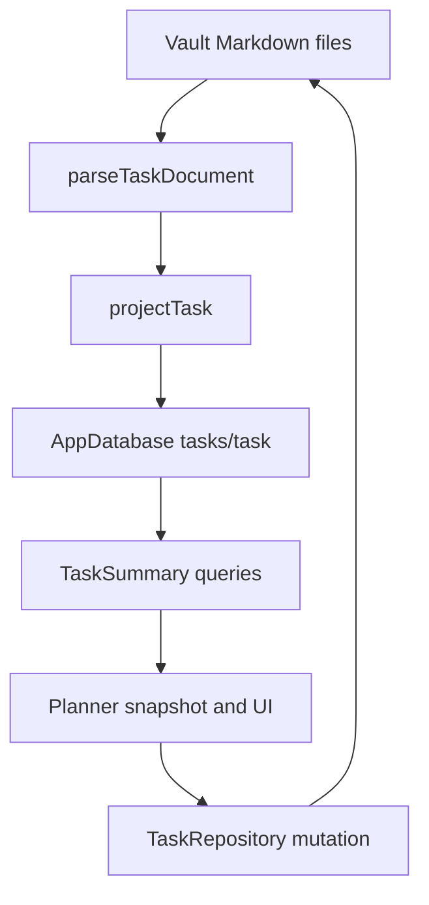

# Runtime

Vault Markdown is the source of truth. AppDatabase holds a disposable public
`tasks/task` projection so the planner can query summaries without parsing
every file on each paint. UI must not treat the database as authoritative.
See LN-TASK-020.

## Parse, project, query

`parseTaskDocument` in `src/lib/model/task-document.ts` returns a
`TaskDocument`, `TaskListDocument`, or `TaskNavigationDocument`.
`projectTask` in `src/lib/model/task-projection.ts` writes a typed projection
row. `task-index.ts` registers that projection and emits edges for reserved
section links.

Planner lists and cards read `TaskSummary` rows through `TaskRepository`
query wrappers. Detail and editor surfaces may reload the Markdown
`TaskDocument`. `TaskSummary` carries indexed planning fields: status, inbox,
start, plan, deadline, checklist counts, and comment count. Plan kind is
`anytime`, `morning`, `afternoon`, `evening`, or `time`, with `planTime` for
clock values. It does not include body prose or comments text.

## Query views

`matchesTaskView` in `src/lib/model/task-queries.ts` is the query-AST meaning
for named views. Only `kind: task` rows match. See LN-TASK-018.

| View | Open-task match |
| --- | --- |
| Inbox | `task.inbox` is true |
| Today | `plan.date` or `deadline` is today or earlier |
| Anytime | start is actionable and there is no plan date |
| Upcoming | start date, plan date, or deadline is after today |
| Someday | `start` is `someday` |
| Completed | `status` is `completed` |
| Logbook | `status` is `completed` or `canceled` |
| Review | `plan.date` is before today |

Start is actionable when it is `anytime`, or a date on or before today.
Someday starts are not Anytime. A deadline-only open task is Today or
Upcoming from those dates; catalog adaptation must not treat it as undated
Anytime. Overdue `plan.date` stays in Review until the user reschedules,
completes, skips, or cancels.

The live planner also classifies catalog `Task` rows with `classifyTask` in
`src/lib/model/planner.ts`. That path is the Column Canvas bucket order, not
a second stored flag. See [Planner](./planner.md).

## Repository and file stores

`TaskRepository` in `src/lib/model/task-repository.ts` is the mutation
boundary. Production hosts inject `createVaultTaskFileStore` from
`src/lib/model/vault-task-file-store.ts`, which reads, writes, and trashes
through the public `App` vault. Tests and some catalog paths inject
`createMemoryTaskFileStore`.

`TasksPlugin.onload` registers the public tasks projection, constructs the
repository, loads versioned plugin data, registers the Tasks settings tab, and
mounts `TasksView` with the repository, injected clock, and live settings
source. Plugin data owns only presentation settings; task and list state stays
in Markdown.

Settings saves are serialized. The two local `HH:mm` day-part boundaries must
be valid and ordered. Absent, older, or malformed data uses `12:00` and `17:00`.
After a successful save, every open view receives the persisted snapshot and
reclassifies clock-valued tasks without a file mutation. See LN-TASK-029.

## Mutations

`task-mutations.ts` and repository methods rewrite one Markdown file, or the
parent reserved-section links, then upsert the projection from that parse.
See LN-TASK-019. `TaskRepository.cancel` writes `task.status: canceled`.

- Completing a linked child updates the child file, not a checkbox on the
  parent.
- Rolling complete may reset only `## Checklist`.
- List graph edits (pin, nest, rename, archive, delete) still go through the
  repository and then reproject. See [Lists](./lists.md).
