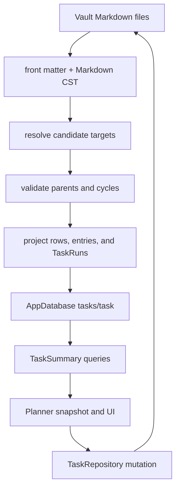

# Runtime

Vault Markdown is the source of truth. AppDatabase holds a disposable public
`tasks/task` projection so the planner can query summaries without parsing
every file on each paint. UI must not treat the database as authoritative.
See LN-TASK-020.



## Parse, project, query

`parseTaskDocument` in `src/lib/model/task-document.ts` returns a
`TaskDocument`, `TaskListDocument`, or `TaskNavigationDocument`.
`task-structure.ts` scans CST ranges, derives heading context, resolves targets,
forms contiguous TaskRuns, and validates the whole structural graph.
`projectTask` writes the summary fields, while `task-index.ts` registers the
projection and emits `task-entry`, `list-entry`, or `navigation-item` edges.
Every structural row includes source ranges and a source hash. An unresolved or
unsupported candidate remains ordinary Markdown and contributes a diagnostic,
not an active edge.

Planner lists and cards read `TaskSummary` rows through `TaskRepository`
query wrappers. Detail and editor surfaces may reload the Markdown
`TaskDocument`. `TaskSummary` carries indexed planning fields: status, inbox,
start, plan, deadline, recurrence, tracking, effective occurrence date/state,
the local date for which those fields were resolved, checklist counts, and
comment count. Plan kind is `anytime`, `morning`, `afternoon`, `evening`, or
`time`, with `planTime` for clock values. Recurrence summaries retain the raw
RRULE, anchor, missed policy, exceptions, pause state, and lifecycle metadata. Summaries
do not include body prose or comments text.
An opaque invalid or legacy mapping uses the same durable recurrence projection
slot with `unsupported` effective state; the catalog adapter separates it from
an executable `TaskRepeat` and presents it to the recurrence editor unchanged.
Catalog adapters preserve the optional checklist total and completed counts
while continuing to exclude checklist item text. See LN-TASK-033.

`TaskRepository.refreshEffectiveOccurrences` serializes recurrence projection
refresh. It runs before the first stale date-sensitive query and is invoked by
plugin startup, visible/focused/pageshow wake-up, and the next-local-date timer.
Markdown and source hashes remain unchanged; only disposable projection rows
are replaced. Open planner workspaces subscribe to completed refreshes and
rebuild their snapshots from those rows.

The retained plugin then materializes only tracked open Tasks with a current
effective occurrence dated today. It uses the existing occurrence repository,
which ensures the daily target before mutation; same-date refresh is idempotent
and never advances the original Task. The [frozen application reference](./runtime/native-coordination.md)
records full selection and daily snapshots before native Notes scheduling.

For a `task-list`, the parser projects the page display title: its top-level
front matter `title`, then its first H1, then a human-readable stable-id
fallback. Repository list renames keep an existing front matter title and H1
in sync before reprojection, so a later mutation cannot silently expose the
raw id. See LN-TASK-015 and LN-TASK-026.

## Query views

`matchesTaskView` in `src/lib/model/task-queries.ts` is the query-AST meaning
for named views. Only `kind: task` rows match. See LN-TASK-018.

| View      | Open-task match                                                                                  |
| --------- | ------------------------------------------------------------------------------------------------ |
| Inbox     | `task.inbox` is true                                                                             |
| Today     | effective occurrence is current or overdue, or a non-recurring plan/deadline is today or earlier |
| Anytime   | start is actionable and there is no plan date                                                    |
| Upcoming  | effective occurrence is future, or a non-recurring start/plan/deadline is after today            |
| Someday   | `start` is `someday`                                                                             |
| Completed | `status` is `completed`                                                                          |
| Logbook   | `status` is `completed` or `canceled`                                                            |
| Review    | effective occurrence is overdue under carry, or a non-recurring plan is before today             |

Start is actionable when it is `anytime`, or a date on or before today.
Someday starts are not Anytime. A deadline-only open task is Today or
Upcoming from those dates; catalog adaptation must not treat it as undated
Anytime. Only carry retains an overdue occurrence in Review. Skip-policy
recurrence resolves its next effective date without writing Task Markdown.

The live planner also classifies catalog `Task` rows with `classifyTask` in
`src/lib/model/planner.ts`. That path is the Column Canvas bucket order, not
a second stored flag. See [Planner](./planner.md).

The plugin also registers public `tasks/occurrence` projection version 1 over
canonical daily notes. Its rows contain task identity and path, daily-document
path, occurrence date, observed outcome and tracking value, plus the exact
source range. `TaskRepository.occurrenceHistory` queries those rows and
`tasks/task`, then uses the package RRULE engine to derive missing expectations.
The projection is disposable: deleting the database and reindexing Task and
daily Markdown recreates the same historical result.

## Native occurrence parser

The private `crates/lapis-task-services` crate is the native source boundary for
read-only `tasks/occurrence` parsing. It takes the complete unmodified daily
Markdown and vault-relative daily-document path, and returns ordered version-1
`TaskOccurrenceRecord` values. Serialization uses the existing camel-case
AppDatabase record fields, omits absent quantitative fields, and preserves
UTF-16 source offsets including CRLF and astral characters.

See LN-TASK-070–071 in the [package requirements](./index.md#requirements).

The host registers projection ID `tasks/occurrence`, owner `tasks`, schema
version 1, public visibility and the existing API-owned field definition. Each
record maps to an `observation` row with its `observationId` as row ID and its
scanner ordinal. Host admission, source hashes, publication limits, errors,
watching and deletion remain native service responsibilities. The parser does
not truncate records or deduplicate observations; the host must report rejected
publication explicitly.

The shared reference corpus is
`crates/lapis-task-services/tests/fixtures/occurrences.json`. Its expected
records were captured from the unchanged TypeScript implementation. Run:

```sh
pnpm exec vitest run --project unit src/lib/model/task-occurrence-native.test.ts src/lib/model/task-occurrence.test.ts src/lib/model/task-occurrence-rebuild.test.ts
cargo test --locked --manifest-path crates/lapis-task-services/Cargo.toml
cargo clippy --locked --manifest-path crates/lapis-task-services/Cargo.toml --all-targets -- -D warnings
cargo fmt --manifest-path crates/lapis-task-services/Cargo.toml -- --check
cargo build --locked --manifest-path crates/lapis-task-services/Cargo.toml
```

This source slice does not activate native occurrence indexing in a host or
replace renderer ownership. Full task parsing, structural resolution,
recurrence, local-date refresh, materialization and Search remain separate
migration work.

## Native document parser source slice

LN-TASK-073–074 govern the private native document parser. Its input is complete
unmodified Markdown plus a vault-relative path; its output matches serialized
`parseTaskDocument` values for Task, Task List and navigation documents. Missing
or unrecognized envelopes return no document. Opaque invalid recurrence,
tracking and priority values, diagnostic order, title defaults, checklists and
structural candidates remain observable. All source offsets use UTF-16 units.

The shared corpus is
`crates/lapis-task-services/tests/fixtures/documents.json`. The TypeScript
oracle remains unchanged; a dedicated test compares its full JSON serialization
with each fixture. Rust acceptance consumes that same file. No subset match,
handwritten replacement oracle or weakened diagnostic expectation qualifies
native parity.

This is parser-only source qualification. RRULE syntax classification needed by
the parser does not implement calendar execution or effective occurrence
resolution. Version-4 `projectTask`, whole-vault target/graph resolution,
registration, publication, date refresh and mutation authority remain later
gates. The existing native occurrence corpus must continue to pass unchanged.

## Private native date-only recurrence

LN-TASK-075 through LN-TASK-077 govern the private native recurrence boundary
after document parsing. Its source implementation uses pinned `rrule=0.14.0`;
no host selects it yet.
The pure recurrence set receives an explicit date-only origin and RRULE,
RDATE and EXDATE values. The effective-occurrence resolver additionally
receives explicit local today and an optional plan date.

The adapter preserves retained date-set and effective-policy results, including
constructor classifications and accepted library edge cases. It reuses the
document parser's rule/date validation and adapts stricter library validation
through library-generated period candidates. Explicit DTSTART/RDATE and EXDATE
keep their retained set precedence independently of primary-rule COUNT.

Shared frozen fixtures contain the original 32 date sets and 18 effective
outcomes, plus two separate negative-ordinal compatibility cases. Both unchanged
TypeScript and native tests compare complete serialized outputs. Source-gate
evidence is retained in
[the recurrence intake](../../../records/2026-10-25-native-task-recurrence.md);
qualification does not imply host adoption or publication.

Whole-vault target/graph resolution, host publication, local-date scheduling,
recurrence mutations and daily observation materialization retain separate gates.
Neither this source slice nor a date-sensitive row alone activates native Tasks
indexing.

## Private native row normalization

LN-TASK-078–079 govern the pure version-4 `project_task` counterpart. Its input
is a native parsed document and explicit local today. Its typed serializable
result preserves complete fields for Tasks, Task Lists and navigation, including
absent versus null task-only values, opaque repeat metadata, planning values
and counts.
It reuses the qualified private effective resolver; no wall clock is captured.
This boundary derives one summary row without resolving graph targets, adding
structural rows/edges, publishing database records or selecting a host writer.
Unchanged TypeScript and native acceptance share 106 frozen complete-output
fixtures covering the qualified parser/effective inputs plus row-specific edge
cases. See [the source intake](../../../records/2026-10-25-native-task-projection.md).
Structure/target resolution, projection envelopes and host publication/lifecycle
remain separate. No host selects this private implementation yet.

## Private per-document structures

LN-TASK-080–081 govern the implemented private headings, candidate/checklist
scanning, supplied read-only target lookup and per-document contiguous TaskRuns.
The private boundary shares
the native Markdown adapter, preserving UTF-16 ranges and retained source hashes.
Lookup results are supplied by the caller; no App, metadata cache or filesystem
access is introduced. Lookup errors must propagate without a fabricated result.

Complete unchanged-TypeScript acceptance covers headings, scans, lookup order,
resolved structures and the structure projection shape. Whole-vault parent/cycle
validation, href/edge envelopes, source publication and host selection remain
separate. A per-document resolved structure is not an admitted whole-vault graph.
The source intake records complete parity and source-gate evidence in
[the per-document structure record](../../../records/2026-10-25-native-task-structure.md).

## Private whole-vault structure validation

LN-TASK-082–083 govern the implemented private source boundary over a complete resolved
snapshot. Multiple-parent edges are excluded before strongly connected cycle
detection. Duplicate occurrences from one source remain distinct, invalid runs
are filtered without changing their source identity, and diagnostics retain
source order. Document paths retain ordered last-value replacement semantics.
Target lookup, href/edge envelopes, publication and either host's native provider
selection remain separate. Complete unchanged-TypeScript capture, exact native
before/after acceptance and complete owner source gates pass. See
[the whole-vault graph source record](../../../records/2026-10-25-native-task-graph.md).

## Private native index envelopes

LN-TASK-084–085 govern the implemented pure source boundary for href normalization,
snapshot-only target lookup, structural/navigation edges and links, tag/metadata
records, indexed files and projection-source envelopes with an explicit local
date. UTF-16 file sizes and existing source/projection identities are retained.
The source returns values only; App/filesystem/database lookup, publication,
provider registration, replacement/pruning, watches and host lifecycle stay with
the admitted host. Complete unchanged-TypeScript parity, exact native before/after
and complete owner source gates pass. See
[the index source record](../../../records/2026-10-25-native-task-index.md).

## Native transformation source

LN-TASK-086–089 define the approved [native transformation contract](./runtime/native-transformations.md).
The unchanged TypeScript oracle/corpus is authored before native exports. Task
and daily-observation transformations return values only; file authority,
materialization scheduling and both host adoptions stay separate. The pure export contract is approved. The frozen unchanged-TypeScript corpus
and new native implementation are undergoing source qualification; read-only
qualification remains unchanged.

## Repository and file stores

`TaskRepository` in `src/lib/model/task-repository.ts` is the mutation
boundary. Production hosts inject `createVaultTaskFileStore` from
`src/lib/model/vault-task-file-store.ts`, which reads, writes, and trashes
through the public `App` vault. Tests and some catalog paths inject
`createMemoryTaskFileStore`.

`TasksPlugin.onload` registers the public task and occurrence projections,
constructs the daily-observation and Task repositories, loads versioned plugin
data, registers the Tasks settings tab, and
mounts `TasksView` with the repository, injected clock, and live settings
source. Plugin data owns only presentation settings; task and list state stays
in Markdown.

The daily-observation repository resolves the API-owned host provider before
writing. On startup and local-date refresh, only tracked schedule occurrences
whose effective state is current for today are proactively materialized.
Tracked recurring completion processes the readable daily list item before writing
the next rolling Task plan. A retry after the second write fails reuses the
same `taskId + occurrenceDate` item. Explicit skip similarly ensures an
unchecked observation before advancement.

The plugin also registers a Tasks section through the public workspace settings
controller. This is the settings surface used by the Lapis workspace shell;
the `PluginSettingTab` remains available to Obsidian-compatible hosts. Both
surfaces persist through the same plugin-owned update queue. Both expose
Navigation column as an enum with Expanded, Collapsed, and Hidden choices.

The same onload registers the plugin-scoped `task-structure-runs` Markdown
contribution through the public API. The contribution supplies a CodeMirror
extension and rendered-Markdown postprocessor but imports neither Lapis
Markdown nor Mira. The API surface context carries an opaque Tasks controller
only for the Tasks-owned file surface; ordinary Markdown surfaces use document
interaction rules. See LN-TASK-035.

Settings saves are serialized. The two local `HH:mm` day-part boundaries must
be valid and ordered. Absent, older, or malformed data uses `12:00` and `17:00`.
The persisted `dailyAgenda.hideOverdueTasks` preference defaults to false and
migrates older data without losing valid boundaries. Version 3 adds
`planner.navigationColumnState`, accepts only `expanded`, `collapsed`, or
`hidden`, and defaults invalid or missing values to `expanded` without
discarding other valid settings. After a successful save, every open view
receives the persisted snapshot. Boundary changes
reclassify clock-valued tasks; the overdue preference changes selected-agenda
inclusion. Navigation state initializes synchronously from `settingsSource.get`
to avoid an expanded mount flash, maps to Column Canvas open/collapse/close,
and persists only Tasks collapse/close layout events. Controller synchronization
is idempotent; resize and transient preview state are excluded. None of these
changes mutates a Task file. See LN-TASK-029 and LN-TASK-056.

## Mutations

`task-mutations.ts` and repository methods rewrite exact Markdown ranges, then
upsert the projection from the new parse.
See LN-TASK-019. `TaskRepository.cancel` writes `task.status: canceled`.

- Completing a linked child updates the child file, not a checkbox on the
  parent.
- A rich TaskRun row merges canonical planner relationship fields into its fresh
  projection-backed task so an absent `listId` cannot become an implicit unlink.
  Title, schedule, completion, reopen, and checklist changes preserve the
  authored structural entry.
- `getTaskDocument` lazily reads checklist contents. A checkbox mutation
  requires its checklist ordinal and expected text, replaces only that marker,
  reparses the file, writes it, and reprojects the new counts. A stale ordinal
  or text raises `TaskChecklistMutationError` without writing.
- Recurring completion and skip follow the RRULE engine, shared resolver,
  observation ordering, lifecycle counter, and checklist rules in [RRULE
  recurrence](./documents/recurrence.md). See LN-TASK-044 and LN-TASK-049–055.
- Structured row and detail controls use the same repository boundary. Exact
  clock values update `task.plan.at`; List changes move the structural parent
  link; recurrence changes replace or clear the complete `task.repeat` value.
  Every successful mutation reparses and reprojects before the UI receives the
  refreshed summary. See LN-TASK-045–046.
- List graph edits (pin, nest, rename, archive, delete) still go through the
  repository and then reproject. See [Lists](./lists.md).
- TaskRun create, reorder, and delete use an editor transaction while the
  document is actively edited; the repository does not write behind that
  buffer. A read-only edit rereads the file, verifies the exact scanned run,
  replaces only that range, and reparses before writing and reprojecting. A
  cross-run move produces exact remove and insert changes and recomputes the
  href if the destination document differs. Stale source fails closed. See
  LN-TASK-036.
- Heading rename and creation operate on ordinary Markdown heading ranges.
  Adding an entry under a heading inserts a normal Markdown list link at that
  heading boundary. No front matter grouping field is written.
- Before planner snapshots consume relationships, whole-vault validation
  rebuilds the active structure, removes conflicting/cyclic edges, and surfaces
  diagnostics. The underlying source remains unchanged.
- Deleting a linked sublist after its active-parent link transaction removes the
  child file and other parent/navigation references while explicitly skipping a
  duplicate repository rewrite of that editor-owned parent.

Metadata mutations preserve explicit tracking patches and distinguish removal of opaque recurrence from an unchanged field. Priority and comments persist in Task Markdown; all date-sensitive actions use the repository clock. Deletion cleans structural parent entries before trashing while retaining descendants and prose references.

Heading actions reject a changed source at the vault transaction boundary.
Navigation and deletion flush open Task file surfaces before closing them.
Deleting a child Task retains its owning List's active editor after flushing its
transaction. Detail history and comments landmarks identify the owning Task.
Preview hiding recognizes semantic checkbox controls inside the host's direct
paragraph or label wrapper, without hiding an unchecked ancestor item merely
because a nested item is complete.
Quantitative history totals and averages are omitted when observations use
incompatible units; completion rates and streaks remain available.

## YAML metadata reader prerequisite

LN-TASK-090 requires native metadata decoding to preserve retained YAML 1.2
Unicode scalar semantics before mutation serialization can qualify. The owning
reader repair is separate from pure transformations and host persistence. See
[Document scalar fidelity](./documents.md#native-yaml-scalar-fidelity) and
[the source record](../../../records/2026-10-25-task-yaml-reader.md).

LN-TASK-091 retains nonfinite priority presence before YAML values become JSON.
The existing unparsed-priority snapshot keeps its retained null representation;
absent and explicit-null priority remain absent. The source-only repair adds no
write authority or host selection. See
[the priority presence record](../../../records/2026-10-25-task-priority-presence.md).

## Native lifecycle planning source

The [private coordination contract](./runtime/native-coordination.md) defines
LN-TASK-092–093. It freezes retained complete/skip observation selection and
partial-write retry behavior before the native pure planner and Notes provider/
persistence intake. It does not select a host or add a scheduler.

The [native lifecycle contract](runtime/native-coordination.md) separates valid
source-owned duration targets from the unchanged legacy normalization corpus.
Its retained source reference qualifies complete observation intent before Notes
adopts ordered daily/Task persistence and recovery.

## Admitted native Task observation

[Native coordination](runtime/native-coordination.md#ln-task-094) defines the selected App-port adapter and source scheduling ownership. Existing repositories delegate qualified actions and complete/skip to the admitted service, retain native outcomes, and stop renderer projection publication and daily materialization in that mode. Existing browser behavior and planner views remain the reference.

The [English daily context source gate](runtime/native-coordination.md#default-daily-locale-qualification) qualifies current en-US week 7/4, declared legacy Intl en-US week 7/1 and en-GB week 1/4 from complete retained outcomes. Notes owns filenames, provider IO and the native writer; actual host timezone/day-boundary and signed-bundle gates remain separate.

[Native outcome presentation](runtime/native-coordination.md#ln-task-096) preserves
known failures and readable uncertainty/inspection identity in existing alerts.
No recovery action is inferred from a missing response.
