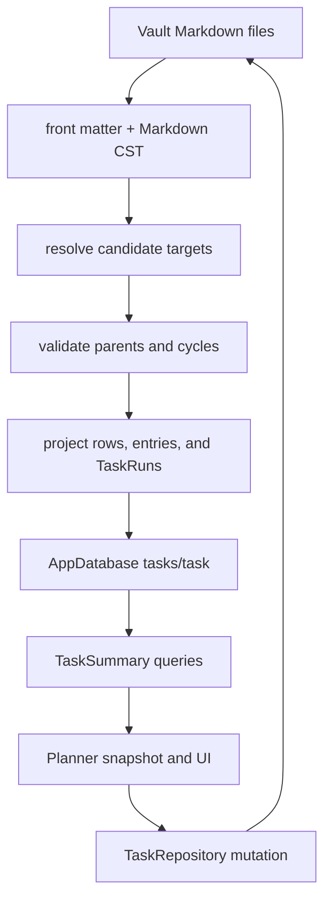

# Runtime

Vault Markdown is the source of truth. AppDatabase holds a disposable public
`tasks/task` projection so the planner can query summaries without parsing
every file on each paint. UI must not treat the database as authoritative.
See LN-TASK-020.

## Parse, project, query

`parseTaskDocument` in `src/lib/model/task-document.ts` returns a
`TaskDocument`, `TaskListDocument`, or `TaskNavigationDocument`.
`task-structure.ts` scans CST ranges, derives heading context, resolves targets,
forms contiguous TaskRuns, and validates the whole structural graph.
`projectTask` writes the summary fields, while `task-index.ts` registers the
projection and emits `task-entry`, `list-entry`, or `navigation-item` edges.
Every structural row includes source ranges and a source hash. An unresolved or
unsupported candidate remains ordinary Markdown and contributes a diagnostic,
not an active edge.

Planner lists and cards read `TaskSummary` rows through `TaskRepository`
query wrappers. Detail and editor surfaces may reload the Markdown
`TaskDocument`. `TaskSummary` carries indexed planning fields: status, inbox,
start, plan, deadline, recurrence, tracking, effective occurrence date/state,
the local date for which those fields were resolved, checklist counts, and
comment count. Plan kind is `anytime`, `morning`, `afternoon`, `evening`, or
`time`, with `planTime` for clock values. Recurrence summaries retain the raw
RRULE, anchor, missed policy, exceptions, pause state, and lifecycle metadata. Summaries
do not include body prose or comments text.
An opaque invalid or legacy mapping uses the same durable recurrence projection
slot with `unsupported` effective state; the catalog adapter separates it from
an executable `TaskRepeat` and presents it to the recurrence editor unchanged.
Catalog adapters preserve the optional checklist total and completed counts
while continuing to exclude checklist item text. See LN-TASK-033.

`TaskRepository.refreshEffectiveOccurrences` serializes recurrence projection
refresh. It runs before the first stale date-sensitive query and is invoked by
plugin startup, visible/focused/pageshow wake-up, and the next-local-date timer.
Markdown and source hashes remain unchanged; only disposable projection rows
are replaced. Open planner workspaces subscribe to completed refreshes and
rebuild their snapshots from those rows.

For a `task-list`, the parser projects the page display title: its top-level
front matter `title`, then its first H1, then a human-readable stable-id
fallback. Repository list renames keep an existing front matter title and H1
in sync before reprojection, so a later mutation cannot silently expose the
raw id. See LN-TASK-015 and LN-TASK-026.

## Query views

`matchesTaskView` in `src/lib/model/task-queries.ts` is the query-AST meaning
for named views. Only `kind: task` rows match. See LN-TASK-018.

| View | Open-task match |
| --- | --- |
| Inbox | `task.inbox` is true |
| Today | effective occurrence is current or overdue, or a non-recurring plan/deadline is today or earlier |
| Anytime | start is actionable and there is no plan date |
| Upcoming | effective occurrence is future, or a non-recurring start/plan/deadline is after today |
| Someday | `start` is `someday` |
| Completed | `status` is `completed` |
| Logbook | `status` is `completed` or `canceled` |
| Review | effective occurrence is overdue under carry, or a non-recurring plan is before today |

Start is actionable when it is `anytime`, or a date on or before today.
Someday starts are not Anytime. A deadline-only open task is Today or
Upcoming from those dates; catalog adaptation must not treat it as undated
Anytime. Only carry retains an overdue occurrence in Review. Skip-policy
recurrence resolves its next effective date without writing Task Markdown.

The live planner also classifies catalog `Task` rows with `classifyTask` in
`src/lib/model/planner.ts`. That path is the Column Canvas bucket order, not
a second stored flag. See [Planner](./planner.md).

The plugin also registers public `tasks/occurrence` projection version 1 over
canonical daily notes. Its rows contain task identity and path, daily-document
path, occurrence date, observed outcome and tracking value, plus the exact
source range. `TaskRepository.occurrenceHistory` queries those rows and
`tasks/task`, then uses the package RRULE engine to derive missing expectations.
The projection is disposable: deleting the database and reindexing Task and
daily Markdown recreates the same historical result.

## Repository and file stores

`TaskRepository` in `src/lib/model/task-repository.ts` is the mutation
boundary. Production hosts inject `createVaultTaskFileStore` from
`src/lib/model/vault-task-file-store.ts`, which reads, writes, and trashes
through the public `App` vault. Tests and some catalog paths inject
`createMemoryTaskFileStore`.

`TasksPlugin.onload` registers the public task and occurrence projections,
constructs the daily-observation and Task repositories, loads versioned plugin
data, registers the Tasks settings tab, and
mounts `TasksView` with the repository, injected clock, and live settings
source. Plugin data owns only presentation settings; task and list state stays
in Markdown.

The daily-observation repository resolves the API-owned host provider before
writing. On startup and local-date refresh, only tracked schedule occurrences
whose effective state is current for today are proactively materialized.
Quantitative completion processes the readable daily list item before writing
the next rolling Task plan. A retry after the second write fails reuses the
same `taskId + occurrenceDate` item. Explicit skip similarly ensures an
unchecked observation before advancement.

The plugin also registers a Tasks section through the public workspace settings
controller. This is the settings surface used by the Lapis workspace shell;
the `PluginSettingTab` remains available to Obsidian-compatible hosts. Both
surfaces persist through the same plugin-owned update queue.

The same onload registers the plugin-scoped `task-structure-runs` Markdown
contribution through the public API. The contribution supplies a CodeMirror
extension and rendered-Markdown postprocessor but imports neither Lapis
Markdown nor Mira. The API surface context carries an opaque Tasks controller
only for the Tasks-owned file surface; ordinary Markdown surfaces use document
interaction rules. See LN-TASK-035.

Settings saves are serialized. The two local `HH:mm` day-part boundaries must
be valid and ordered. Absent, older, or malformed data uses `12:00` and `17:00`.
The persisted `dailyAgenda.hideOverdueTasks` preference defaults to false and
migrates version-1 data without losing valid boundaries. After a successful
save, every open view receives the persisted snapshot. Boundary changes
reclassify clock-valued tasks; the overdue preference changes selected-agenda
inclusion. Neither change mutates a Task file. See LN-TASK-029.

## Mutations

`task-mutations.ts` and repository methods rewrite exact Markdown ranges, then
upsert the projection from the new parse.
See LN-TASK-019. `TaskRepository.cancel` writes `task.status: canceled`.

- Completing a linked child updates the child file, not a checkbox on the
  parent.
- A rich TaskRun row merges canonical planner relationship fields into its fresh
  projection-backed task so an absent `listId` cannot become an implicit unlink.
  Title, schedule, completion, reopen, and checklist changes preserve the
  authored structural entry.
- `getTaskDocument` lazily reads checklist contents. A checkbox mutation
  requires its checklist ordinal and expected text, replaces only that marker,
  reparses the file, writes it, and reprojects the new counts. A stale ordinal
  or text raises `TaskChecklistMutationError` without writing.
- Recurring completion and skip follow the RRULE engine, shared resolver,
  observation ordering, lifecycle counter, and checklist rules in [RRULE
  recurrence](./documents/recurrence.md). See LN-TASK-044 and LN-TASK-049–055.
- Structured row and detail controls use the same repository boundary. Exact
  clock values update `task.plan.at`; List changes move the structural parent
  link; recurrence changes replace or clear the complete `task.repeat` value.
  Every successful mutation reparses and reprojects before the UI receives the
  refreshed summary. See LN-TASK-045–046.
- List graph edits (pin, nest, rename, archive, delete) still go through the
  repository and then reproject. See [Lists](./lists.md).
- TaskRun create, reorder, and delete use an editor transaction while the
  document is actively edited; the repository does not write behind that
  buffer. A read-only edit rereads the file, verifies the exact scanned run,
  replaces only that range, and reparses before writing and reprojecting. A
  cross-run move produces exact remove and insert changes and recomputes the
  href if the destination document differs. Stale source fails closed. See
  LN-TASK-036.
- Heading rename and creation operate on ordinary Markdown heading ranges.
  Adding an entry under a heading inserts a normal Markdown list link at that
  heading boundary. No front matter grouping field is written.
- Before planner snapshots consume relationships, whole-vault validation
  rebuilds the active structure, removes conflicting/cyclic edges, and surfaces
  diagnostics. The underlying source remains unchanged.
- Deleting a linked sublist after its active-parent link transaction removes the
  child file and other parent/navigation references while explicitly skipping a
  duplicate repository rewrite of that editor-owned parent.
